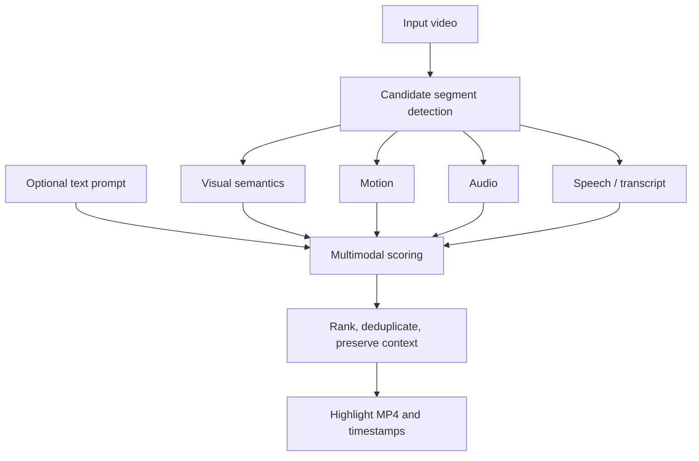

# SceneSift

**General-Purpose Multimodal Video Summarization and Highlight Extraction**

> **Project status:** The pipeline, the interface, five selection methods, and the evaluation harness are implemented and tested, and both benchmarks have been run. On the held-out TVSum test the classical computer-vision method and the activity baseline agree with annotators far better than the methods built on CLIP features, and the blend fitted on SumMe does not beat the classical method alone. See [Results](#results). The paper's discussion is still to be written.

SceneSift investigates whether a single, category-independent computer vision pipeline can find meaningful moments in different kinds of video and assemble concise highlight reels. Rather than hardcoding rules for one kind of video, the proposed approach combines visual semantics, motion, audio, and spoken language. An optional natural-language request allows users to express what matters to them—for example, “Find exciting moments” or “Summarize the discussion about AI.”

## Research question

**Does blending classical computer-vision cues with learned multimodal features select highlights that agree with human annotators better than either kind of evidence alone, across the video categories of public benchmarks?**

Strong performance on arbitrary video is an aspiration, not an established claim.

## Features

- A report page (`python app.py`) that presents the method and results as a short paper and applies the five selection methods to a video you upload, with a rendered reel, timestamps, and evidence for each.
- A command-line tool that produces a highlight MP4, source timestamps, and a rationale for each clip, with an optional natural-language request.
- Candidate segments scored from classical cues, audio, and pretrained models, with graceful handling of videos without speech or audio.
- An evaluation runner that compares the methods on annotated videos, fits the blend's weights, and reports F1 and rank correlation.

## Quick start

Requires Python 3.10+. FFmpeg is used from `PATH` when installed; otherwise the binary bundled with
`imageio-ffmpeg` is used.

```bash
python -m venv .venv && source .venv/bin/activate
# Without an NVIDIA GPU, install the CPU builds first (much smaller download):
pip install torch torchvision --index-url https://download.pytorch.org/whl/cpu
pip install -r requirements.txt
```

The first run downloads the CLIP, Whisper, and sentence-embedding weights (about 1 GB in total).

```bash
# Report page with a section to test your own video (http://127.0.0.1:7860)
python app.py

# One video from the command line: writes output/highlights.mp4 and output/highlights.json
python -m scenesift summarize video.mp4 --prompt "Find exciting moments" --duration 60

# Compare the methods on annotated videos (see experiments/README.md)
python -m scenesift evaluate experiments/manifest.csv --budgets 15% --ablations

# Fit the blend's weights on development videos
python -m scenesift fit experiments/manifest.csv --split train --out configs/fitted.yaml

# Tests (no model downloads needed)
python -m unittest discover -s tests -v
```

## Results

Mean over videos. F1 is overlap with each annotator's summary at a 15% budget; Kendall's τ is rank
correlation with each annotator's scores. Full tables, paired tests, ablations, and per-category
results are in [experiments/SUMME_RESULTS.md](experiments/SUMME_RESULTS.md) and
[experiments/TVSUM_RESULTS.md](experiments/TVSUM_RESULTS.md).

| Method | SumMe F1 | SumMe τ | TVSum F1 | TVSum τ |
| --- | --- | --- | --- | --- |
| Uniform reference | 0.172 | n/a | 0.143 | n/a |
| A: activity (motion + audio) | 0.195 | 0.066 | 0.176 | 0.097 |
| B: semantic (CLIP visual only) | 0.165 | 0.067 | 0.144 | −0.057 |
| C: multimodal | 0.207 | 0.102 | 0.150 | −0.009 |
| D: classical CV | 0.186 | 0.046 | 0.180 | 0.088 |
| Blend, weights fitted on SumMe | 0.193 (held out) | 0.080 (held out) | 0.147 | 0.028 |
| Agreement between annotators | 0.311 | 0.229 | 0.250 | 0.178 |

SumMe (25 videos) is the development set; the blend's SumMe figures come from leave-one-video-out
fitting. TVSum (50 videos) was run once with everything fixed beforehand.

- **Classical cues hold up; CLIP distinctiveness does not.** On TVSum the classical method and the
  activity baseline are clearly ahead of the semantic and multimodal methods on rank correlation
  (differences of about 0.10 to 0.15, intervals well clear of zero), and the classical method is the
  only one distinguishably above evenly spaced clips on F1.
- **The multimodal method does not generalize.** It leads on SumMe, within noise, and is at chance on
  TVSum. Its visual feature, which without a request scores how unusual a clip looks, is negatively
  related to annotator importance on TVSum.
- **The blend does not beat its parts.** Weights fitted on SumMe do not improve on the untuned
  multimodal method on held-out SumMe videos, and on TVSum the blend is below the classical method.
- **Tuning the multimodal weights does not rescue it.** Weights chosen on SumMe score worse than the
  untuned ones on held-out SumMe videos and move TVSum rank correlation only from −0.009 to 0.014.
  Weights fitted within TVSum (cross-validated) reach 0.086, level with the classical method, by
  putting two thirds of the weight on motion.
- **Against published work.** On TVSum the classical method (τ 0.088) is above the trained dppLSTM
  (0.042) and DR-DSN (0.020) as measured by Otani et al., and below the best training-free method
  (0.135) and supervised methods (up to 0.194). On SumMe no method here reaches the 2014 hand-built
  method's F1 of 0.234.

Other known limitations: visually unusual content (title and logo cards, a watermarked clip, the one
colour shot in a black-and-white reel) can be rated as a highlight whether or not it matters; speech
under loud music is often missed by the transcription step; scores are relative within one video and
are not comparable across videos; request-guided selection is available from the command line and is not
measured.

## Pipeline



See the detailed [system architecture](docs/ARCHITECTURE.md).

## Study design

| Approach | Evidence used | Purpose |
| --- | --- | --- |
| A — Activity baseline | Motion and audio intensity | Detect visually/acoustically active moments |
| B — Semantic baseline | Visual-semantic signals | Test semantic selection without other modalities |
| C — Proposed multimodal approach | Visual, motion, audio, transcript, novelty, optional prompt | Test whether combining evidence helps |
| D — Classical CV | Hand-built cues only: colour histograms, edges, frame differences, optical flow | Test how far fundamentals go without pretrained models |
| Blend | Classical and learned evidence with weights fitted on SumMe | Test whether the two kinds of evidence complement each other |

All methods are evaluated on the same videos at matched summary-duration budgets, alongside a uniform reference (evenly spaced clips). Metrics are time-overlap precision/recall/F1, event coverage, redundancy, processing time, and, on TVSum, rank correlation with the annotators' importance scores. TVSum results will be reported **separately by video category**, including failure cases.

## Evaluation data

| | SumMe | TVSum |
| --- | --- | --- |
| Videos | 25 personal videos, unedited or minimally edited, 67 minutes in total | 50 YouTube videos, 5 in each of 10 categories (tire changing, sandwich making, animal grooming, parkour, parades, flash mobs, beekeeping, bike tricks, dog shows, getting a vehicle unstuck) |
| Human labels | 15–18 people each selected the frames they would keep in a 15% summary | 20 people each scored every 2-second shot from 1 (not important) to 5 (very important) |
| Role | Already run; fusion weights are fitted on it | Held-out test set; per-category results |

Neither dataset has text requests, so both test generic highlights. Requests are supported by the command-line tool and are not measured. Details are in [docs/DATASETS.md](docs/DATASETS.md).

## Published results to compare against

On SumMe, with the same scoring used here (F-measure averaged over annotators, summary of 15% of the video):

| Method | F-measure |
| --- | --- |
| Uniform sampling (Gygli et al. 2014) | 0.143 |
| Colour-histogram clustering (Gygli et al. 2014) | 0.163 |
| Hand-built interestingness features (Gygli et al. 2014) | 0.234 |
| SceneSift classical CV (this repository) | 0.186 |
| SceneSift multimodal, untuned (this repository) | 0.207 |
| Agreement between annotators | 0.311 |

On TVSum, the main measure is rank correlation with the annotators' scores (Kendall's τ), because overlap scores there barely separate random selections from published methods (Otani et al. 2019):

| Method | TVSum τ |
| --- | --- |
| Random | 0.000 |
| dppLSTM, supervised (Otani et al. 2019) | 0.042 |
| Zero-shot scoring from pretrained features (Pang et al. 2024) | 0.135 |
| SceneSift classical CV (this repository) | 0.088 |
| VASNet, supervised (as listed by Son et al. 2024) | 0.160 |
| CSTA, supervised (Son et al. 2024) | 0.194 |
| Human | 0.177 |

SceneSift trains no network, so the targets were the 2014 hand-built method on SumMe (0.234) and the zero-shot method on TVSum (0.135). Neither was reached. The full tables and sources are in [docs/DATASETS.md](docs/DATASETS.md#published-results).

## Project documentation

- [Experiment design](docs/EXPERIMENT.md) — Research question, hypotheses, data, evaluation, risks; intentionally **no implementation details**.
- [Implementation](docs/IMPLEMENTATION.md) — Technology stack, algorithms, data flow, scoring, and where each stage lives in the code.
- [Architecture diagrams](docs/ARCHITECTURE.md) — Mermaid processing and comparison diagrams.
- [Report page and demonstration](docs/UI.md) — Running the page and testing a video.
- [Research report](research/README.md) — The LaTeX report and its figures.
- [Datasets and published results](docs/DATASETS.md) — What SumMe and TVSum contain, and the numbers reported on them by other papers.
- [Running the comparison](experiments/README.md) — Manifest and annotation formats, metrics, and outputs.
- [SumMe results](experiments/SUMME_RESULTS.md) — Development-set results and checks on other footage.
- [TVSum results](experiments/TVSUM_RESULTS.md) — Held-out test results, by category and against published work.
