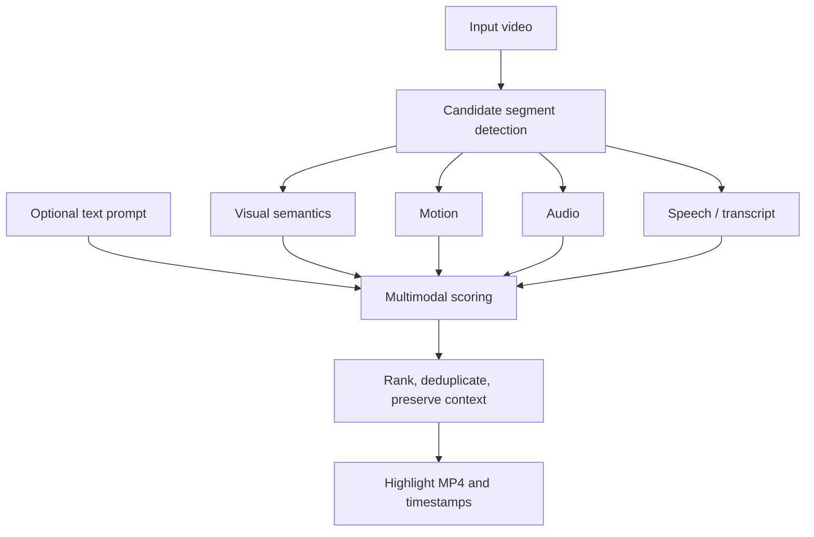

# SceneSift

**General-Purpose Multimodal Video Summarization and Highlight Extraction**

> **Project status:** The pipeline, the interface, and the evaluation harness are implemented and tested. A first benchmark run on SumMe is recorded in [experiments/SUMME_RESULTS.md](experiments/SUMME_RESULTS.md): the proposed method had the highest mean score but was not distinguishable from the activity baseline or from evenly spaced clips. The study compares classical computer-vision cues, learned features, and a blend of the two on two public, human-labelled benchmarks, SumMe and TVSum. The classical method, the blend, rank-correlation metrics, and the TVSum run are **not done yet**.

SceneSift investigates whether a single, category-independent computer vision pipeline can find meaningful moments in different kinds of video and assemble concise highlight reels. Rather than hardcoding rules for one kind of video, the proposed approach combines visual semantics, motion, audio, and spoken language. An optional natural-language request allows users to express what matters to them—for example, “Find exciting moments” or “Summarize the discussion about AI.”

## Research question

**Does blending classical computer-vision cues with learned multimodal features select highlights that agree with human annotators better than either kind of evidence alone, across the video categories of public benchmarks?**

Strong performance on arbitrary video is an aspiration, not an established claim.

## Features

- Upload a video and optionally specify a natural-language highlight request.
- Choose a target highlight duration.
- Locate candidate segments and score their relevance/importance using the available evidence.
- Select informative moments with limited repetition and sufficient narrative context.
- Output a highlight MP4, source timestamps, and a brief summary or rationale.
- Gracefully handle videos without speech or audio.
- Compare the proposed method against the two baselines on annotated videos from the command line.

## Quick start

Requires Python 3.10+. FFmpeg is used from `PATH` when installed; otherwise the binary bundled with
`imageio-ffmpeg` is used.

```bash
python -m venv .venv && source .venv/bin/activate
# Without an NVIDIA GPU, install the CPU builds first (much smaller download):
pip install torch torchvision --index-url https://download.pytorch.org/whl/cpu
pip install -r requirements.txt
```

The first run downloads the CLIP, Whisper, and sentence-embedding weights (about 1 GB in total).

```bash
# Interface
python app.py

# One video from the command line: writes output/highlights.mp4 and output/highlights.json
python -m scenesift summarize video.mp4 --prompt "Find exciting moments" --duration 60

# Compare methods A, B and C on annotated videos (see experiments/README.md)
python -m scenesift evaluate experiments/manifest.csv --budgets 30 60 120 --ablations

# Tests (no model downloads needed)
python -m unittest discover -s tests -v
```

## What is and is not done

| Area | State |
| --- | --- |
| Candidate segments, visual/motion/audio/speech evidence, fusion, selection, MP4 export | Implemented |
| Gradio interface with timestamps and per-clip evidence | Implemented |
| Baselines A and B, ablations, temporal F1, event coverage, redundancy, runtime | Implemented |
| SumMe benchmark run (25 videos, generic highlights) | Done once, untuned; mixed result |
| Classical-CV-only method | **Not implemented** |
| TVSum converter, TVSum run, rank-correlation metrics | **Not done** |
| Fusion weights | Untuned starting values; fitting on SumMe **not done** |
| Prompt demonstration, worked examples, paper results section | **Not done** |

Known limitations observed so far: visually unusual content (title and logo cards, a watermarked
clip, the one colour shot in a black-and-white reel) can be rated as a highlight whether or not it
matters; speech under loud music is often missed by the transcription step; scores are relative
within one video and are not comparable across videos.

## Pipeline



See the detailed [system architecture](docs/ARCHITECTURE.md).

## Study design

| Approach | Evidence used | Purpose |
| --- | --- | --- |
| A — Activity baseline | Motion and audio intensity | Detect visually/acoustically active moments |
| B — Semantic baseline | Visual-semantic signals | Test semantic selection without other modalities |
| C — Proposed multimodal approach | Visual, motion, audio, transcript, novelty, optional prompt | Test whether combining evidence helps |
| D — Classical CV (planned) | Hand-built cues only: colour histograms, edges, frame differences, optical flow | Test how far fundamentals go without pretrained models |
| Blend (planned) | Classical and learned evidence with weights fitted on SumMe | Test whether the two kinds of evidence complement each other |

All methods are evaluated on the same videos at matched summary-duration budgets, alongside a uniform reference (evenly spaced clips). Metrics are time-overlap precision/recall/F1, event coverage, redundancy, processing time, and, on TVSum, rank correlation with the annotators' importance scores. TVSum results will be reported **separately by video category**, including failure cases.

## Evaluation data

| | SumMe | TVSum |
| --- | --- | --- |
| Videos | 25 personal videos, unedited or minimally edited, 67 minutes in total | 50 YouTube videos, 5 in each of 10 categories (tire changing, sandwich making, animal grooming, parkour, parades, flash mobs, beekeeping, bike tricks, dog shows, getting a vehicle unstuck) |
| Human labels | 15–18 people each selected the frames they would keep in a 15% summary | 20 people each scored every 2-second shot from 1 (not important) to 5 (very important) |
| Role | Already run; fusion weights are fitted on it | Held-out test set; per-category results |

Neither dataset has text requests, so both test generic highlights. Requests are shown by example in the interface and are not measured. Details are in [docs/DATASETS.md](docs/DATASETS.md).

## Published results to compare against

On SumMe, with the same scoring used here (F-measure averaged over annotators, summary of 15% of the video):

| Method | F-measure |
| --- | --- |
| Uniform sampling (Gygli et al. 2014) | 0.143 |
| Colour-histogram clustering (Gygli et al. 2014) | 0.163 |
| Hand-built interestingness features (Gygli et al. 2014) | 0.234 |
| SceneSift multimodal, untuned (this repository) | 0.206 |
| Agreement between annotators | 0.311 |

On TVSum, the main measure is rank correlation with the annotators' scores (Kendall's τ), because overlap scores there barely separate random selections from published methods (Otani et al. 2019):

| Method | TVSum τ |
| --- | --- |
| Random | 0.000 |
| dppLSTM, supervised (Otani et al. 2019) | 0.042 |
| Zero-shot scoring from pretrained features (Pang et al. 2024) | 0.135 |
| VASNet, supervised (as listed by Son et al. 2024) | 0.160 |
| CSTA, supervised (Son et al. 2024) | 0.194 |
| Human | 0.177 |

SceneSift trains no network, so the targets are the 2014 hand-built method on SumMe (0.234) and the zero-shot method on TVSum (0.135). The full tables and sources are in [docs/DATASETS.md](docs/DATASETS.md#published-results).

## Project documentation

- [Experiment design](docs/EXPERIMENT.md) — Research question, hypotheses, data, evaluation, risks; intentionally **no implementation details**.
- [Implementation](docs/IMPLEMENTATION.md) — Technology stack, algorithms, data flow, scoring, and where each stage lives in the code.
- [Architecture diagrams](docs/ARCHITECTURE.md) — Mermaid processing and comparison diagrams.
- [Interface](docs/UI.md) — Running and using the Gradio app.
- [Datasets and published results](docs/DATASETS.md) — What SumMe and TVSum contain, and the numbers reported on them by other papers.
- [Running the comparison](experiments/README.md) — Manifest and annotation formats, metrics, and outputs.
- [SumMe results](experiments/SUMME_RESULTS.md) — First benchmark run and checks on other footage.
