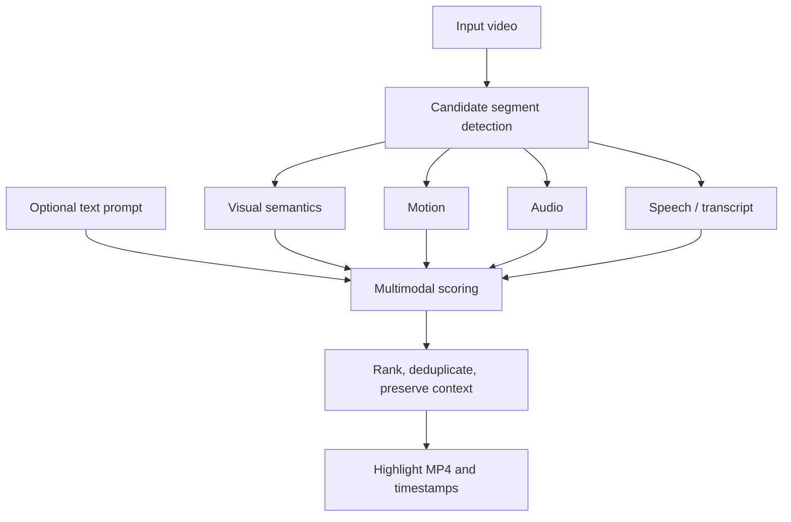

# SceneSift

**General-Purpose Multimodal Video Summarization and Highlight Extraction**

> **Project status:** Research design and planning only. No models, experiments, or software features are claimed to be implemented yet.

SceneSift investigates whether a single, category-independent computer vision pipeline can find meaningful moments in different kinds of video and assemble concise highlight reels. Rather than hardcoding basketball events, the proposed approach combines visual semantics, motion, audio, and spoken language. An optional natural-language request allows users to express what matters to them—for example, “Find exciting moments” or “Summarize the discussion about AI.”

## Research question

**Can a multimodal, category-independent highlight ranking method select more relevant, diverse, and context-preserving clips across different video types than activity-based and visual-semantic baselines?**

Basketball is the **primary demonstration**. Gaming, podcasts/interviews, and travel/vlogs are additional test domains. Strong performance on arbitrary video is an aspiration, not an established claim.

## Intended features

- Upload a video and optionally specify a natural-language highlight request.
- Choose a target highlight duration.
- Locate candidate segments and score their relevance/importance using the available evidence.
- Select informative moments with limited repetition and sufficient narrative context.
- Output a highlight MP4, source timestamps, and a brief summary or rationale.
- Gracefully handle videos without speech or audio.

## Conceptual pipeline

See the detailed [system architecture](docs/ARCHITECTURE.md).

## Study design

| Approach | Evidence used | Purpose |
| --- | --- | --- |
| A — Activity baseline | Motion and audio intensity | Detect visually/acoustically active moments |
| B — Semantic baseline | Visual-semantic signals | Test semantic selection without other modalities |
| C — Proposed multimodal approach | Visual, motion, audio, transcript, novelty, optional prompt | Test whether combining evidence helps |

All methods will be evaluated on the same held-out videos at matched summary-duration budgets. Planned metrics include time-overlap precision/recall/F1, event coverage, redundancy, human relevance judgments, and processing time. Results will be reported **separately by video category**, including failure cases.

## Initial evaluation domains

| Domain | What it tests | Illustrative highlights |
| --- | --- | --- |
| Basketball | Fast action and audio reactions | Important plays, celebrations |
| Gaming | Synthetic visuals and rapid transitions | Notable encounters, achievements |
| Podcast/interview | Speech-dominant meaning, little motion | Key claims and explanations |
| Travel/vlog | Scene diversity and narrative continuity | Distinctive scenery and experiences |

The initial target is **3–5 legally usable videos per category**, annotated by human reviewers. Explore **SumMe** and **TVSum** for supplementary benchmarking, subject to their annotation protocols, license terms, and relevance.

## Project documentation

- [Experiment design](docs/EXPERIMENT.md) — Research question, hypotheses, data, evaluation, risks; intentionally **no implementation details**.
- [Implementation plan](docs/IMPLEMENTATION.md) — Candidate technology stack, algorithms, data flow, scoring, and milestones.
- [Architecture diagrams](docs/ARCHITECTURE.md) — Mermaid processing and comparison diagrams.
