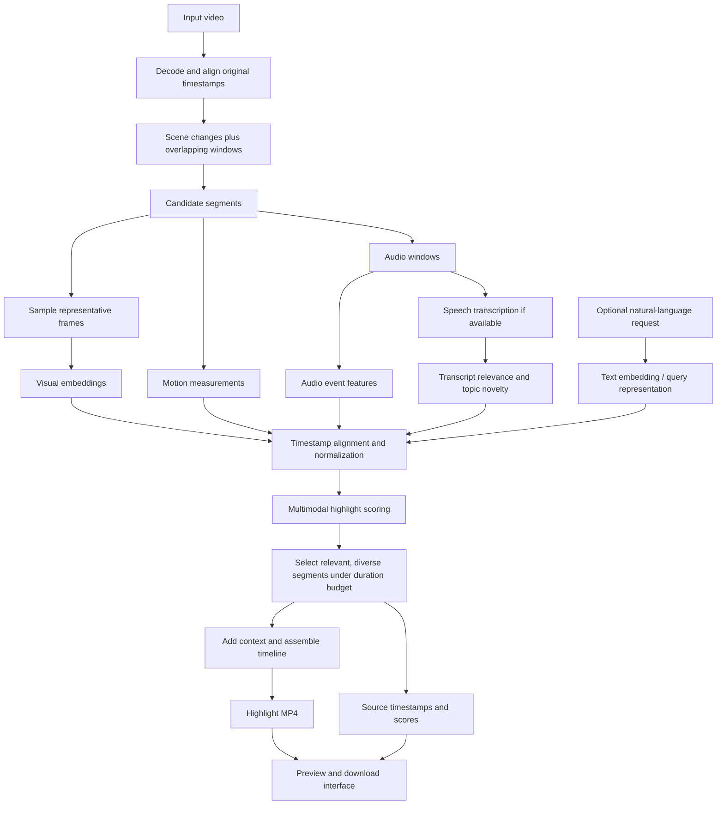
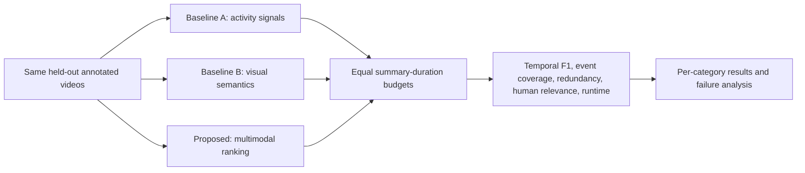

# SceneSift — Proposed Architecture

> These diagrams describe a prospective design, not an existing implementation.

## End-to-end processing

## Research comparison

## Architecture principles

- **Category-independent:** The same candidate/feature/scoring structure is applied to basketball, gaming, podcasts, and travel videos. Category labels are for evaluation, not hardcoded detection rules.
- **Temporal coherence:** Scene boundaries alone are insufficient; overlapping windows preserve events occurring within long shots.
- **Missing evidence:** Silent videos or missing speech bypass unavailable branches. Remaining feature contributions are renormalized.
- **Prompt guidance:** A request biases relevance but is not guaranteed to identify every complex or multi-frame event.
- **Non-redundancy:** Selected clips must jointly cover distinct useful moments within the configured duration budget.
- **Fair evaluation:** Compared methods use the same test videos and budgets, with no tuning on final test annotations.

See [README](../README.md), [Experiment](EXPERIMENT.md), and [Implementation](IMPLEMENTATION.md).
